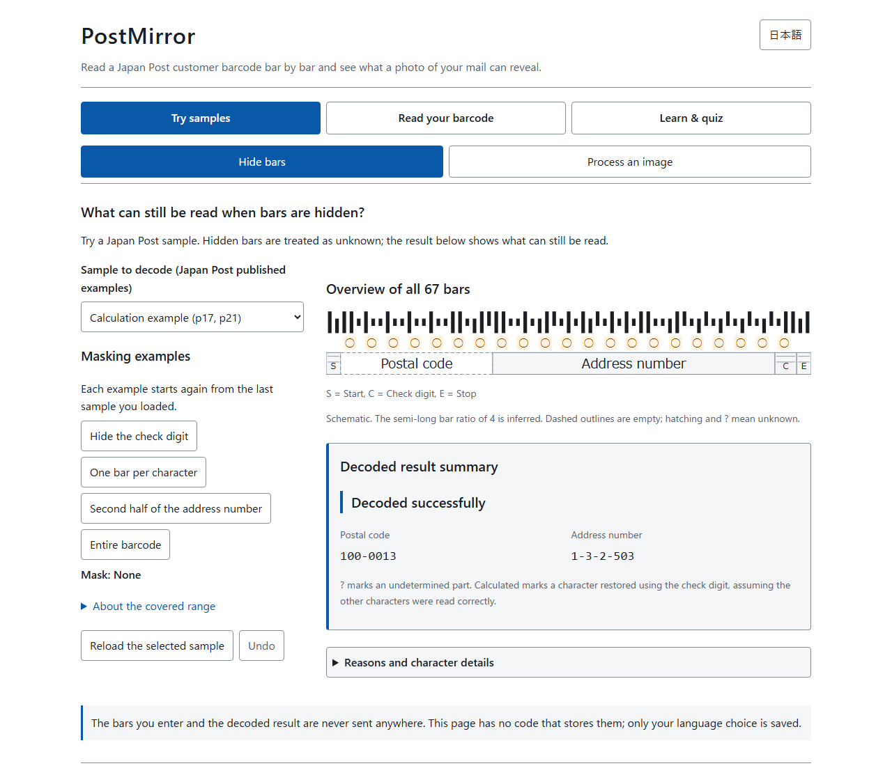
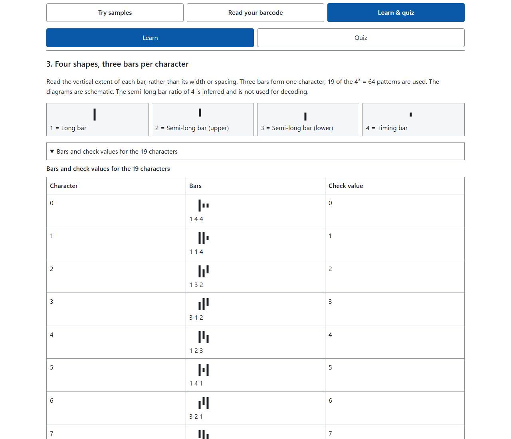
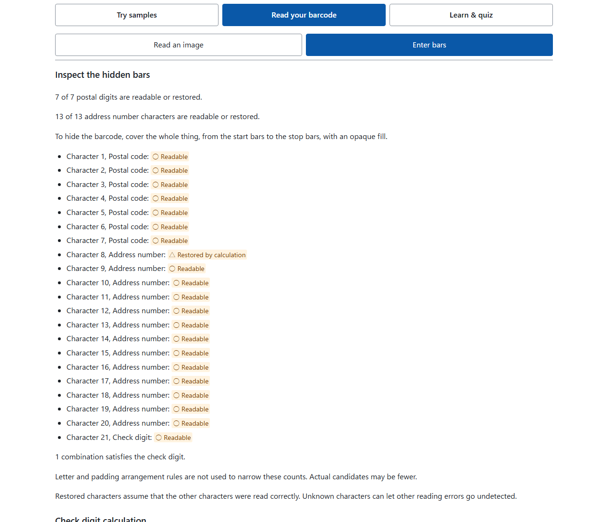
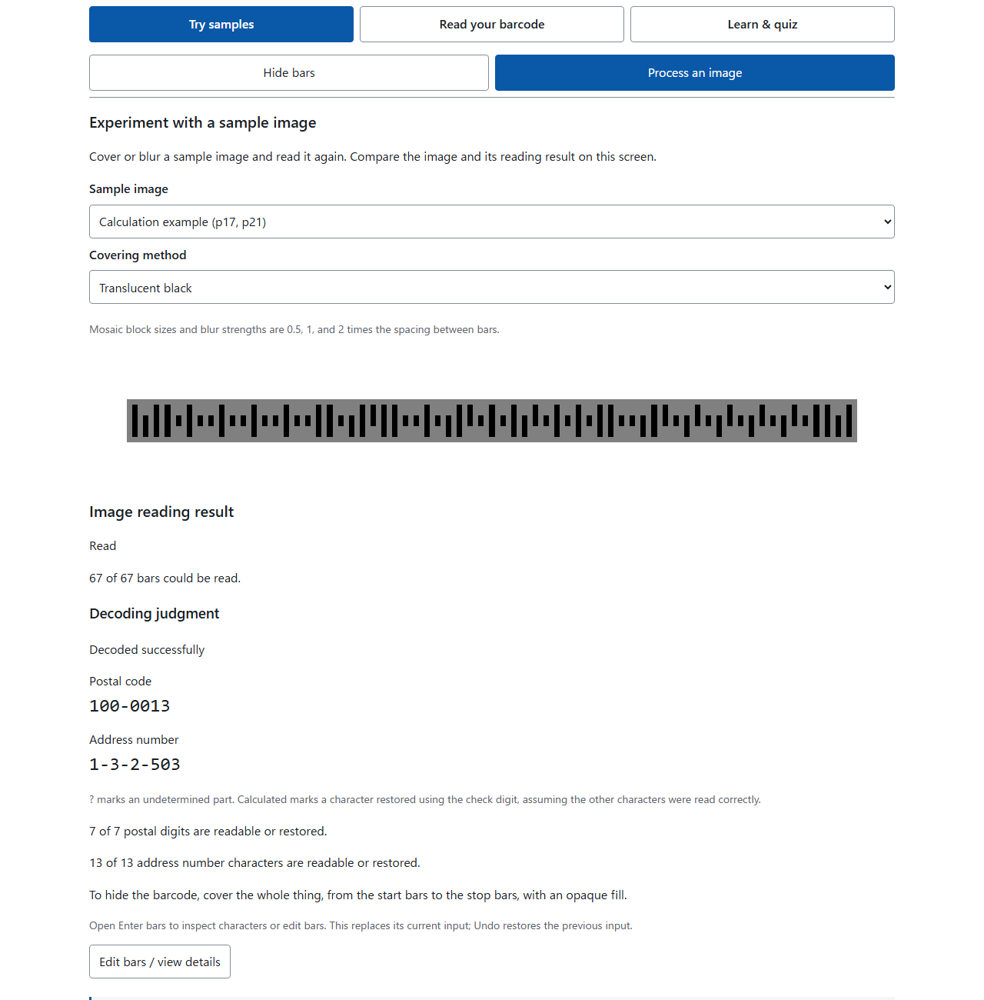

English · [日本語](README.md)

# PostMirror - See What the Barcode on Your Mail Reveals


[](https://ipusiron.github.io/postmirror/)

**Day115 - Security Tools with Generative AI 200**

PostMirror decodes the Japan Post customer barcode printed on mail in Japan. Enter its bars, and it shows the postal code and the address number (the block, lot and room digits) character by character, along with which characters stay readable when part of the barcode is hidden and which ones the check digit restores.
Learn & quiz explains how to read the bars, how the check digit is calculated, and how to hide the barcode.
Start with mail addressed to you.

The name: "post" means both mail and a social media post. PostMirror is a mirror for checking your own mail before you post.

NW-7 (Codabar) image inspection and learning have moved to Day116, [Codabar Lens](https://ipusiron.github.io/codabar-lens/).
PostMirror focuses on Japan Post customer barcodes. Both may appear on mail or labels, but they are different formats.

| Comparison | PostMirror | Codabar Lens |
|---|---|---|
| Format | Japan Post customer barcode | NW-7 / Codabar |
| Encoding | Four bar heights and positions | Bar and space widths |
| Content | Postal code and address number | Digits and symbols; meaning depends on the issuer |

## 🌐 Demo

[Open PostMirror](https://ipusiron.github.io/postmirror/)

PostMirror runs in your browser. Download the repository and open `index.html` in a browser to use it over `file://`.
For local HTTP, run `python -m http.server` at the repository root and visit `http://localhost:8000/`.

## 📸 Screenshots



> *Hide bars in Try samples: choose a sample and a mask, then inspect the remaining information on the same screen.*



> *Learn section 3: the four bar shapes and the beginning of the 19-symbol table.*



> *Bars 24–26 marked unknown. The first address character is distinguished by “△ Restored by calculation”.*



> *All 67 bars in the calculation example (p17, p21) remain readable under translucent black.*

## ✨ Features

- Three purpose areas: Try samples, Read your barcode, and Learn & quiz
- Apply 14 covering methods to sample images in Process an image and check what can be read
- Open your own image on your device and read a region selected in two stages
- Results alongside the controls, with separate sample and personal bar inputs
- Enter 67 bars using character cards and a shape palette showing the selected position and entered count
- See the symbol for a completed three-bar card before entering all 67 bars
- Type or paste sequences, load eight examples published by Japan Post, and reload the selected sample
- Decode postal codes and address numbers, assemble letters, and inspect each character
- Check the check-digit calculation and choose an operation to reread a different orientation
- Mark a range unknown, try four masking examples, or mark the remaining empty bars unknown
- See readable, restored, and undetermined characters, candidate counts, and unapplied text edits
- Undo the previous bulk operation once
- Explore 12 learning sections with diagrams, tables, and step-by-step extraction, plus seven Quiz questions
- Switch between Japanese and English, with dark colors following your device setting

## 📖 How to use

Choose your purpose, then the method you want to use.

| Purpose | Method | What it does |
|---|---|---|
| Try samples | Hide bars | Mark bars in Japan Post public examples unknown and inspect the remaining information |
| Try samples | Process an image | Cover or blur a sample image and inspect what can be read from it |
| Read your barcode | Read an image | Choose an image of mail addressed to you and read a selected region |
| Read your barcode | Enter bars | Paste a bar string or enter the shapes of all 67 bars |
| Learn & quiz | Learn / Quiz | Explore 12 explanatory sections and seven questions |

The worked example and its result appear immediately, ready for trying masks. Controls and results sit side by side on wide screens and stack vertically on narrow screens. Sample bars and Enter bars keep separate values, and Enter bars starts empty. The purpose tabs and the method tabs below them stay at the top while scrolling. Switching tabs brings the beginning of the selected screen into view. When a tab has focus, use left/right arrows for adjacent tabs or Home/End for the first/last tab.

1. Hide bars under Try samples already displays the Japan Post calculation example and its result. Choose other examples from "Sample to decode". Change the mask to compare readable characters and characters restored by calculation without leaving the screen. The selected button and the mask label show which mask is active.
2. Each example, such as "Hide the check digit", starts from the selected sample. "Second half of the address number" means bars 45-67, including the check digit and stop. "Reload the selected sample" restores its original bars, and Undo restores the previous bulk operation once, including the active mask.
3. In Process an image, choose a sample image and a covering method. Inspect the image reading result, the readable bar count, the postal code and address number, and the decoding judgment on the same screen. Compare this image-reading experiment with Hide bars, which treats selected bars as unknown.
4. Under Read your barcode, open Read an image, check the supported-shape example, and choose an image. Follow steps 1/4-4/4: tap left and right in the overview, then left and right in the enlarged views. Tap along the central band where even the short bars pass. Use "Go back one step" to correct a tap.
5. Filled circles mean read, hollow circles mean shape unclear, and crosses mean bar not visible. Read the postal code, address number, and inspection result on the same screen. Use "Select the region again" to choose the endpoints again and "Clear the image" to remove the image and its reading result. Leaving this screen, including switching to Enter bars, also clears the image and its reading result.
6. To change individual bars in a sample, open its result details and choose "Edit this sample's bars". This copies the currently displayed bars into Enter bars and keeps the sample state intact. For an image experiment or your own image, use "Edit bars / view details" to copy the read bars. Both actions replace the current Enter bars input; Undo restores the previous input. For your own image, the bars are copied before the image is cleared.
7. In the Enter bars text field, use 1-4, the aliases F/A/D/T (either case), and "?" for unknown bars. Spaces, newlines, commas, and vertical bars are ignored as separators. Full-width forms are normalized, but circled digits and similar characters are rejected. Only valid text containing exactly 67 bars is applied. Until then, the displayed result is identified as belonging to the last applied bars.
8. Open "Inspect or edit all 67 bars" to enter bars while preserving the current values. Select a bar and press 1-4 or "?" in the palette. The palette shows the selected position and entered count, and the next bar scrolls clear of it. Each completed three-bar card shows its symbol, but decoding and inspection start only when all 67 bars are entered. "Close the bar editor" returns to the collapsed heading.
9. Use left/right arrows for adjacent bars, up/down for adjacent cards, and Home/End for the first/last bar. Enter 1-4, F/A/D/T, or ?. Backspace clears the current bar and moves back; Delete clears it without moving. After pressing a shape button in the palette, you can continue entering bars with the keyboard.
10. After partial entry, use "Mark remaining empty bars as unknown". It preserves entered and already unknown bars, changes only empty positions, and updates the result. One Undo restores the empty positions. Set the start and end positions from 1 to 67, then press "Mark this range as unknown". Clear preserves whether the bar editor is open or closed. Editing a single bar or the text discards the previous bulk-operation undo state.
11. Compare the result summary with the overview of all 67 bars. Open the judgment reasons, checksum calculation, or character breakdown when needed. Distinguish "○ Readable", "△ Restored by calculation", and "■ Undetermined (N candidates)". Counts use position constraints and the check digit, without filtering address-sequence rules, so actual candidates may be fewer. Restored characters assume the other characters were read correctly.
12. In Learn & quiz, use the takeaways and contents in Learn to explore its 12 sections. The tables in sections 3 and 5 start closed on narrow screens and share their open state across languages. Answer seven questions in Quiz, follow a related section, and return to the original question with "Return to Qn in Quiz". Switching screens or languages preserves the sample and direct-input values and results, and the Quiz answers.

Cover the entire barcode, from start to stop, with an opaque solid fill. Export a separate file and reopen it yourself to check the result.

## 🎯 Use cases

### Uses specific to this tool

1. Demonstrate in a class or workplace training that covering only the check digit leaves the contents recoverable. For the official example `100-0013` / `1-3-2-503`, the 20-character sum 105 restores CD = 9. Use it to practice choosing what to cover.
2. Compare error detection with correction. Changing one bar in each of the 19 symbols produces 171 cases: 141 are absent from the table, and 30 become another symbol. If all other characters are readable, the check digit detects the latter, but cannot locate the mistake. Compare this with error correction in Day102 QRCrashTest.
3. Count the weakness of partial masking using only the character table. Of 57 cases of hiding one bar in the 19 symbols, 27 are uniquely determined by the two remaining bars, and 30 have two candidates. If that is the only unreadable character, the check digit also restores it uniquely. Use the counts to explain what remains before covering a few bars.
4. Count candidates while practicing masking several characters. In the same official example, hiding postal characters 1 and 2 leaves 2 combinations; hiding address characters 1 and 2 leaves 12 combinations. Hiding all seven postal characters still leaves 501,529 combinations, about 5% of 10⁷. Compare these approaches with covering the whole barcode opaquely.
5. Check whether room digits survive in a long address. In the official verification example (p25), the extracted `29-1524-23-2-501` contains 16 characters, but only 13 characters, `29-1524-23-2-`, are encoded; `501` is omitted. Use this as a guide when reading the digits on your own mail.
6. Consider whose number appears on a reply envelope. In the official example `100-8792`, all 13 address positions contain CC4, and sum 209 gives CD = 0. Individual postal codes and similar cases may carry no numeric address number. Explain that the barcode on business reply mail identifies the recipient, not the person returning it.

### General uses

- Education: calculate mod 19 by hand in computing or mathematics lessons and learn error detection through familiar mail.
- Security at work: demonstrate with public examples that postal codes and address digits remain even when the name and address are covered.
- Mailing operations: check whether a printed barcode contains the intended numbers. The tool does not inspect dimensions, print quality, or reflectance and cannot replace postal acceptance inspection.
- Public relations: inspect codes visible on invitations or parcels before posting photos.
- Everyday life: check your own mail before posting photos on social media or marketplace apps and discuss what to cover with your family.
- Hobbies: build clues involving four bar shapes for puzzles or ARGs. Japan Post asks that this barcode not encode information other than the destination on the surface of mail (p13).
- Research: use it as a starting point for comparing the structure with British RM4SCC or US IMb. PostMirror decodes the Japan Post customer barcode.
- Combined workflow: inspect photo location data with Day007, barcode contents with PostMirror, and before/after masking differences with Day021.

## 🔬 Technical details

The Japan Post customer barcode uses four states and three bars per character. Read the vertical extensions from the central band, rather than thickness or spacing.

| Input | Shape | Extension |
|---|---|---|
| 1 (F) | Long bar | Both directions |
| 2 (A) | Semi-long bar (upper) | Up |
| 3 (D) | Semi-long bar (lower) | Down |
| 4 (T) | Timing bar | Central band only |

F/A/D/T are input aliases. The display uses Japan Post's numbers 1–4. The semi-long bar length ratio of 4 in diagrams is inferred and is not used for dimensional inspection.

| Section | Characters | Bars |
|---|---:|---:|
| Start | Not counted (marker) | 2 |
| Postal code | 7 | 21 |
| Address number | 13 | 39 |
| Check digit | 1 | 3 |
| Stop | Not counted (marker) | 2 |
| Total | 21 (excluding start and stop) | 67 |

| Symbol | Bars | Check value |
|---|---|---:|
| 0 | 144 | 0 |
| 1 | 114 | 1 |
| 2 | 132 | 2 |
| 3 | 312 | 3 |
| 4 | 123 | 4 |
| 5 | 141 | 5 |
| 6 | 321 | 6 |
| 7 | 213 | 7 |
| 8 | 231 | 8 |
| 9 | 411 | 9 |
| - | 414 | 10 |
| CC1 | 324 | 11 |
| CC2 | 342 | 12 |
| CC3 | 234 | 13 |
| CC4 | 432 | 14 |
| CC5 | 243 | 15 |
| CC6 | 423 | 16 |
| CC7 | 441 | 17 |
| CC8 | 111 | 18 |

Start is `13` and stop is `31`. Only the 19 patterns in the table are used for characters out of 4³ = 64 possible patterns.
Let S be the sum of the check values for the 20 data characters. The check digit is calculated as follows.

```text
CD = (19 − (S mod 19)) mod 19
1+0+0+0+0+1+3 = 5
1+10+3+10+2+10+5+0+3+14+14+14+14 = 100
S = 105, CD = 9 (p21)
S = 209 = 19 × 11, CD = 0 (p22)
```

A letter takes two characters: a control code and a digit. CC1 + 0–9 gives A–J, CC2 + 0–9 gives K–T, and CC3 + 0–5 gives U–Z. For example, B is CC1 + 1.
Address numbers shorter than 13 characters are padded with CC4. After expanding letters, positions beyond the 20th data character are truncated; a letter's control code in position 20 is retained.

The sum of all 21 check values must be divisible by 19, so one unreadable character is uniquely recoverable from the other 20.
However, when a character is unreadable, mistakes in other characters may go undetected. A restored character assumes that the others were read correctly. Swapping two characters also leaves the sum unchanged and is not detected. The check digit is neither error correction nor confirmation that an address exists.

Process an image applies 14 covering methods to synthetic barcodes and reads 67 bars within the selected region.
The image core estimates a grid of bar positions, corrects the endpoints, and classifies extensions above and below the central band. Confidence below 0.2 is treated as unknown. Neither reading nor endpoint selection uses the check digit. If no grid can be established, the result is unreadable.
For your own image, region selection has two stages: choose near both ends in the overview, then select the leftmost and rightmost bars in enlarged views. Crop coordinates are integers clamped to the image bounds before being passed to `drawImage`.
All cases within the specified synthetic-image range matched, but incorrect bars remain outside that range. Conditions and counts appear under Tests. An unreadable result does not mean that other methods cannot read the image.

The primary source is Japan Post's postal code and barcode manual (in Japanese).

- [p11: shapes and character table](https://www.post.japanpost.jp/service/search/zipcode/zipmanual/p11.html)
- [p12: structure, dimensions, and 13 positions](https://www.post.japanpost.jp/service/search/zipcode/zipmanual/p12.html)
- [p13: printing positions and conditions](https://www.post.japanpost.jp/service/search/zipcode/zipmanual/p13.html)
- [p17: extraction example](https://www.post.japanpost.jp/service/search/zipcode/zipmanual/p17.html)
- [p19: extraction rules](https://www.post.japanpost.jp/service/search/zipcode/zipmanual/p19.html)
- [p20: truncation at 20 positions](https://www.post.japanpost.jp/service/search/zipcode/zipmanual/p20.html)
- [p21: check-digit calculation](https://www.post.japanpost.jp/service/search/zipcode/zipmanual/p21.html)
- [p22: individual postal codes and PO boxes](https://www.post.japanpost.jp/service/search/zipcode/zipmanual/p22.html)
- [p23: bulk postal codes for business reply mail](https://www.post.japanpost.jp/service/search/zipcode/zipmanual/p23.html)
- [p25: official verification examples](https://www.post.japanpost.jp/service/search/zipcode/zipmanual/p25.html)

When Read an image locates the bars, it displays the postal code and address number directly, including partial results. `?` marks undetermined content; Calculated marks characters restored using the check digit. Checksum and orientation notes remain visible. No values appear when bar positions cannot be located.

## 🔒 Security

Entered bars, selected images, and decoded results are processed on your device and are not sent anywhere. The page has no code to store results in the URL, localStorage, sessionStorage, IndexedDB, or cookies. Only the language setting `postmirror.lang` is saved in localStorage.

- Images are opened only on the device, without sending or saving them
- Images are drawn on canvas without blob URLs or img elements
- “Clear the image” also releases the image held in memory
- CSP remains unchanged; `blob:` is not added to `img-src`
- CSP `connect-src 'none'` blocks script-initiated connections
- No dependencies, CDN resources, or external fonts
- Rendering uses `textContent` and similar DOM operations; input is not interpreted as HTML
- Input is limited to 1,000 UTF-16 code units and accepts only the allowed symbols
- External links use `noopener noreferrer`, and the page uses `no-referrer`

Reloading clears input, but the browser's Back operation may restore a page held in memory. Reopening a closed tab has not been tested.
GitHub Pages does not allow setting `X-Frame-Options`, so embedding cannot be prohibited through that header.

## ⚠️ Notes

PostMirror is an independent personal project and is not affiliated with or endorsed by Japan Post Co., Ltd.
The barcode specification follows the postal code and barcode manual published by Japan Post (in Japanese).

Names, building names, and parts truncated beyond the 20th data position cannot be read. The code does not indicate which digits are the block, lot, building, or room number.
No postal-code database is bundled, and place names are not displayed. In-office barcodes, ID barcodes, parcel-label codes, tracking numbers, and foreign postal barcodes are not supported.

The author does not encourage misuse.
Whether you may handle photos or barcodes of mail depends on the laws and circumstances of your country or region.

## ❓ FAQ

Q. Is this an official Japan Post tool?

A. No. It is an independent personal project and is not affiliated with Japan Post Co., Ltd.

Q. Can it read an image?

A. Open Read an image under Read your barcode and check the supported format first. Equal-height, varying-width barcodes and QR codes are not supported. Tap near both ends of the barcode, then tap the leftmost and rightmost bars in enlarged views to set the region. The image is opened only on your device; it is neither sent anywhere nor saved. Leaving this screen, including switching to Enter bars, clears the image and its reading result. Automatic detection within a whole photo is planned for a later version. Even if this tool cannot read an image, other methods may be able to read it.

Q. Does it show place names?

A. No. It displays the postal code and address number. Anyone can look up a postal code to find the town area, so a barcode in a photo can reveal the area where you live even though this tool does not show place names.

Q. Is data sent anywhere?

A. Entered bars, selected images, and decoded results are not sent off your device. Only the language setting is saved.

Q. Which mail carries it?

A. Mainly bulk business mail such as direct mail and invoices, and business reply envelopes and postcards. Ordinary stamped personal mail generally would not carry it; this is an inference from Japan Post's guidance.

Q. Is mosaic masking enough?

A. They are not recommended. Images treated with mosaic or blur retain values calculated from the original information. Cover the whole barcode opaquely, export a separate file, and reopen it yourself to check it.

## 🔗 Related tools

- [Day007 Image Exif Checker](https://ipusiron.github.io/image-exif-checker/): check and remove location data embedded in a photo; PostMirror covers the barcode visible in the photo
- [Day013 WhereShot](https://ipusiron.github.io/whereshot/): see how capture time and place can be inferred from a photo
- [Day021 ImageDiffSec](https://ipusiron.github.io/image-diff-sec/): compare images before and after masking to find what was left
- [Day022 DancingMen CipherLab](https://ipusiron.github.io/dancingmen-cipherlab/): practice decoding pictorial cipher symbols with a table; PostMirror reads the bars in a photo
- [Day039 URLPurifier](https://ipusiron.github.io/urlpurifier/): the same idea of removing extra information before sharing
- [Day061 Seal Tamper Lab](https://ipusiron.github.io/seal-tamper-lab/): learn the physical security of envelopes and seals
- [Day074 QR Risk Radar](https://ipusiron.github.io/qr-risk-radar/): assess a different code printed on mail (QR codes) before following the link it contains
- [Day102 QRCrashTest](https://ipusiron.github.io/qrcrashtest/): try error correction in QR codes; the Japan Post customer barcode's check digit only detects errors, though it always restores a single unreadable character
- [Day114 Hex Dump Trainer](https://ipusiron.github.io/hex-dump-trainer/): practice reading encoded data yourself from positions and tables

## 🧪 Tests

Run `npm test` with Node.js 22 or later. No dependency installation is required.
Tests cover 21 official examples, 17 extraction examples, known bar sequences, round trips, boundaries, invalid input, masking, orientation, HTML, language consistency, formatting, and contrast. README examples and numbers are also recalculated with the core. GitHub Actions runs Test automatically on push and pull_request.

```sh
npm test
```

Image tests cover synthetic rendering, covering operations, grid-based reading, endpoint correction, and treating confidence below 0.2 as unknown. Browser checks cover two-stage selection, cropping with integer coordinates clamped to image bounds, and releasing image resources.

The synthetic-image evaluation contains 23,693 cases. The normal range uses nine official and 20 fictional examples, pitches of 6, 7.5, 9, and 12 px, rotations of 0, ±5, and ±10 degrees, blur of 0 or 0.25 pitch, and noise standard deviation of 0 or 8. Each selected endpoint is offset by up to ±1 pitch along the line and ±1.5 pitches perpendicular to it.

| Evaluation condition | Cases | All 67 bars match | Incorrect bars | Falsely confirmed results |
|---|---:|---:|---:|---:|
| Normal range with endpoint offsets | 2,320 | 2,320 | 0 | 0 |
| Worst endpoint combinations within range | 3,712 | 3,712 | 0 | 0 |
| Outside range: translucent black, blur of 0.25 pitch, and endpoint offsets | 1,160 | 997 | 532 | 0 |
| Outside range: strong noise (standard deviation 25) | 29 | 10 | 1 | 0 |

The worst endpoint combinations use 29 examples, pitches of 6 and 12 px, rotations of 0 and 10 degrees, blur of 0 and 0.25 pitch, noise standard deviation of 8, and 16 endpoint combinations. There were no falsely confirmed results across all 23,693 cases. A falsely confirmed result has decoder status ok or recovered but a postal code or address number different from the original. The 533 incorrect bars outside the range show that these results do not guarantee correct reading of arbitrary photos. An additional evaluation at ±2 pitches along the line contained one unreadable case, so uniform tolerance out to ±3 pitches has not been established.


## 📁 Directory structure

```text
postmirror/                         # Tool root
├── .github/                        # GitHub settings
│   └── workflows/                  # GitHub Actions workflows
│       └── test.yml                # Node 22 syntax checks and npm test on push and pull_request
├── .gitignore                      # Excludes secrets and node_modules/
├── CLAUDE.md                       # Developer guide, commands, rules, and structure
├── LICENSE                         # Full MIT License
├── README.md                       # Japanese README with YAML metadata
├── README.en.md                    # English README
├── package.json                    # Dependency-free node --test command
├── index.html                      # Three purpose areas with two methods each, plus CSP
├── style.css                       # Responsive layout, light and dark colors
├── barcode-core.js                 # Character table, check digit, decoding, and encoding
├── extract-core.js                 # Address-number extraction rules
├── image-core.js                   # Synthetic images and image processing
├── samples.js                      # Versioned public examples and extraction examples
├── messages.js                     # Japanese and English messages
├── app.js                          # UI, image loading, input, rendering, languages, and tabs
├── assets/                         # Japanese README screenshots
│   ├── screenshot.png              # Sample controls and results
│   ├── screenshot2.png             # Bar shapes and character table
│   ├── screenshot3.png             # Masking inspection
│   ├── screenshot4.png             # Decoded result in dark colors
│   ├── screenshot5.png             # Experiment with translucent black over a sample
│   └── en/                         # English README screenshots
│       ├── screenshot.png          # Sample controls and results in English
│       ├── screenshot2.png         # Bar shapes and table in English
│       ├── screenshot3.png         # Masking inspection in English
│       └── screenshot4.png         # Sample image experiment in English
└── test/                           # node:test tests
    ├── official-vectors.json       # Independent expectations for 21 examples and nine complete bar sequences
    ├── core.test.js                # Tables, known answers, restoration, candidates, orientation, and properties
    ├── extract.test.js             # Extraction stages and 17 public examples
    ├── image.test.js               # Independent image-processing tests
    ├── readme.test.js              # README numbers, structure, images, and language
    ├── html.test.js                # HTML, CSP, storage, and lesson checks
    ├── i18n.test.js                # Message consistency and Japanese literal checks
    ├── format.test.js              # Maximum line length and minimum line counts
    └── contrast.test.js            # Light/dark contrast and focus spacing
```

## 💻 Requirements

- Chromium: input, decoding, masking, learning, and language switching checked over HTTP and `file://`, at widths 320, 390, 768, and 1280 px, in Japanese and English
- Firefox: display and interactions with tabs, languages, samples, masks, inspection, and quizzes checked over HTTP and `file://` at 320 px in both languages and at 390 px in Japanese
- Windows WebKit (webkit-2191): decoding, horizontal overflow, console errors, page errors, and CSP violations checked over HTTP and `file://` at 390 px in both languages. This does not replace testing on iOS Safari
- Image reading checked in Chromium, Firefox, and Windows WebKit (webkit-2191) with synthetic PNG, JPEG, JPEG with EXIF orientation, and downscaling of 5000×4000 images
- Reading rates for real photos, accuracy of finger taps on physical devices, and image loading in iOS Safari (HEIC conversion and downscaling of large photos) remain untested
- Safari, physical smartphones, actual screen-reader speech, and reopening closed tabs remain untested
- JavaScript is required. Back/forward checks confirmed in-memory page restoration in Chromium over HTTP; `file://` and Firefox history behavior was recorded only

## 📄 License

This project uses the MIT License. See [LICENSE](LICENSE) for the full text.

## 🛠️ About this tool

This tool was developed as part of the "Security Tools with Generative AI 200" project.
In this project, a wide range of security-related tools are built and published over 100 days with the help of AI.

For details about the project and the other tools, see the page below.

🔗 [https://akademeia.info/?page_id=44607](https://akademeia.info/?page_id=44607)
