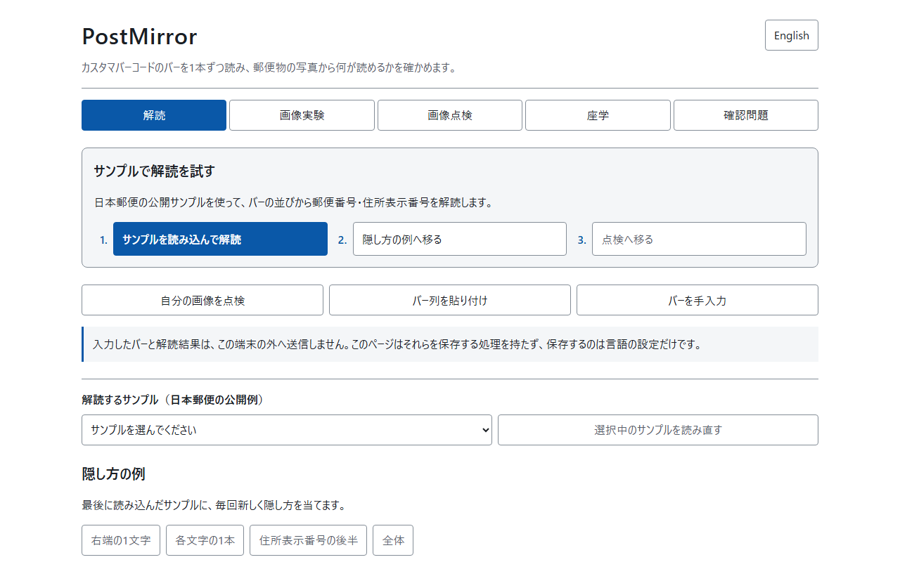
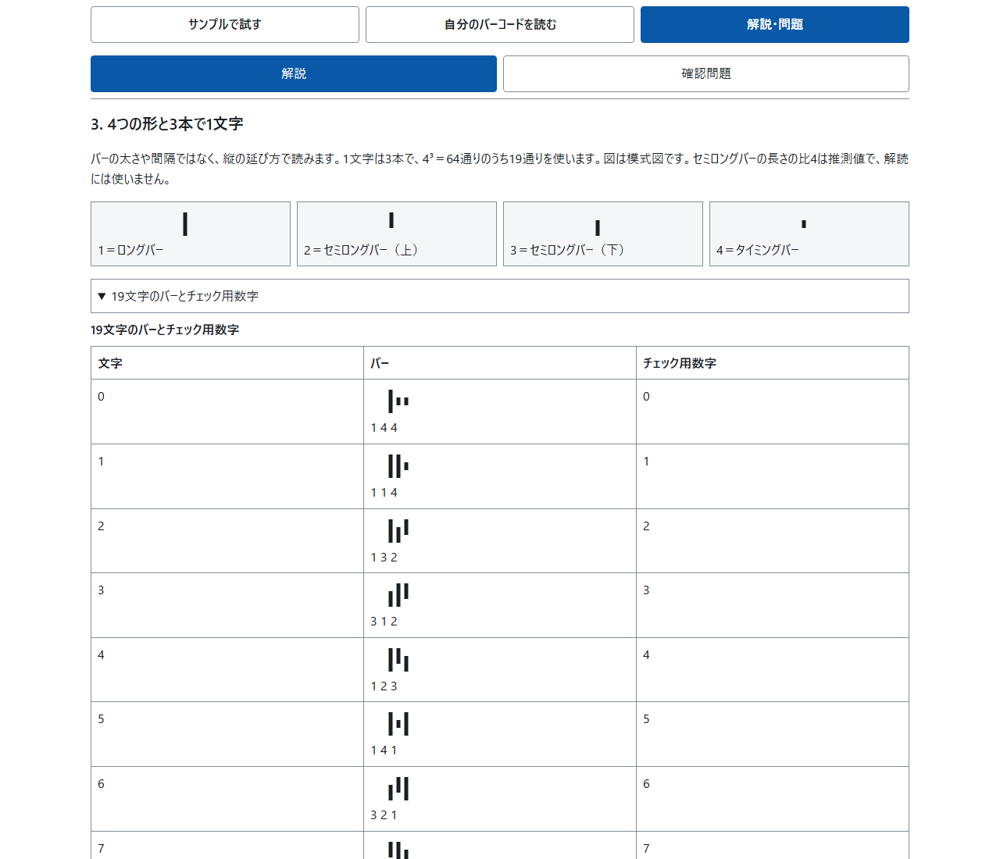
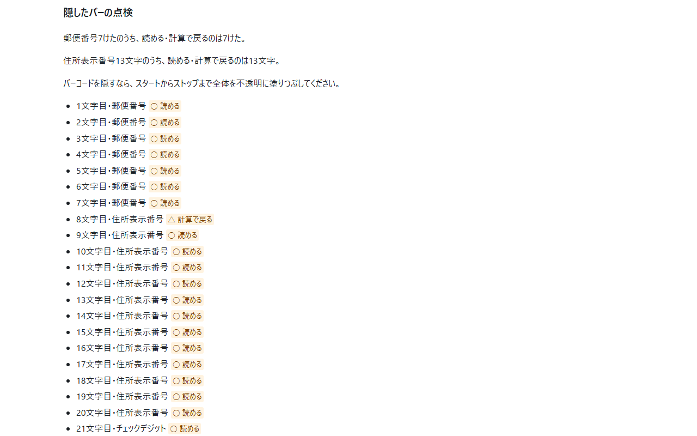
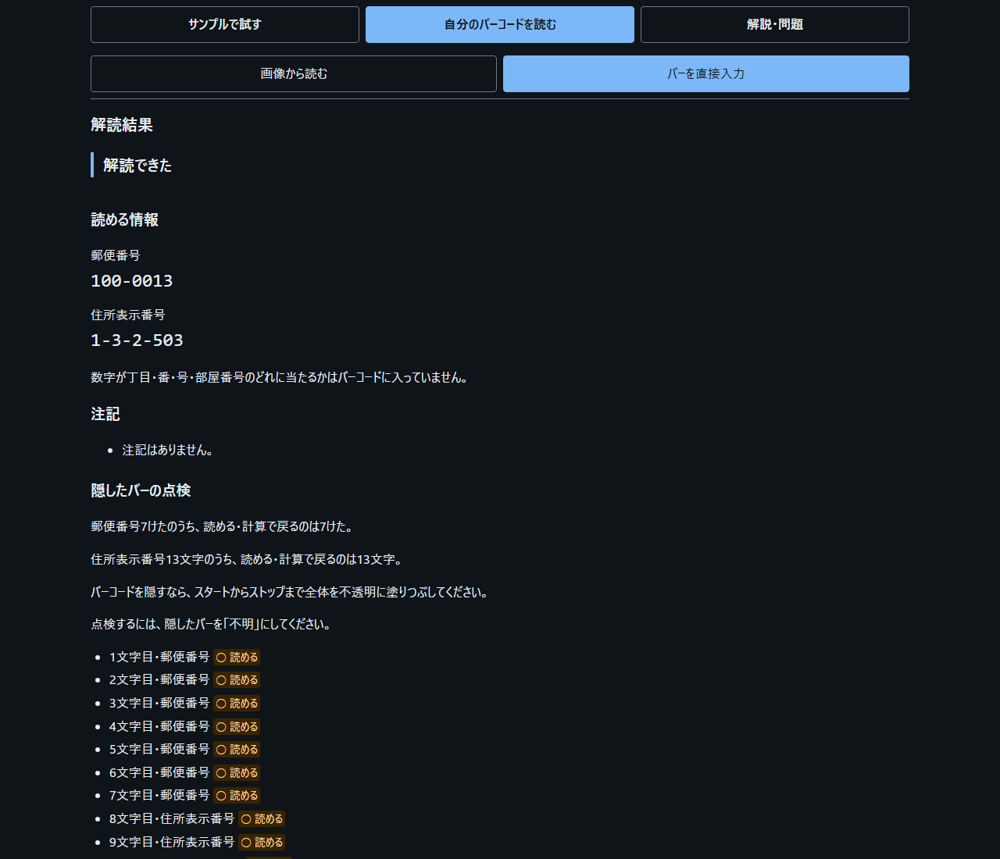
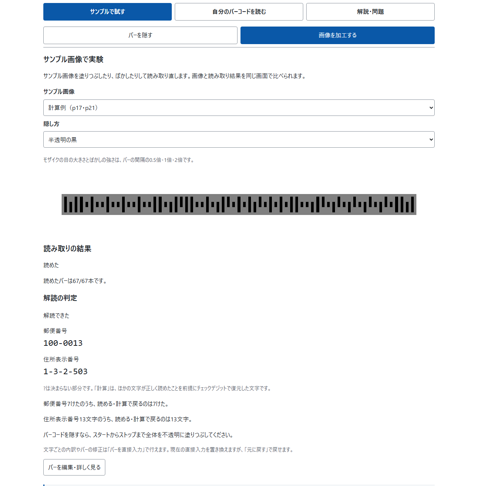

<!--
---
id: day115
slug: postmirror

title: "PostMirror"

subtitle_ja: "郵便物のバーコードから住所の何が読めるかを確かめる"
subtitle_en: "See What the Barcode on Your Mail Reveals"

description_ja: "郵便物のカスタマバーコードのバーを1本ずつ入力して解読し、郵便番号と住所表示番号の内訳と、一部を隠したときに読める文字を確かめる自己点検ツール"
description_en: "A self-check tool that decodes a Japan Post customer barcode entered bar by bar, showing each character of the postal code and address number and what stays readable when parts are hidden"

category_ja:
  - プライバシー
  - 符号理論
category_en:
  - Privacy
  - Coding Theory

difficulty: 2

tags:
  - customer-barcode
  - japan-post
  - barcode
  - postal-code
  - privacy
  - check-digit
  - osint
  - education
  - client-side

repo_url: "https://github.com/ipusiron/postmirror"
demo_url: "https://ipusiron.github.io/postmirror/"

hub: true
---
-->

[English](README.en.md) · 日本語

# PostMirror - 郵便物のバーコードから住所の何が読めるかを確かめる


[](https://ipusiron.github.io/postmirror/)

**Day115 - 生成AIで作るセキュリティツール200**

PostMirror（ポストミラー）は、郵便物に印字されたカスタマバーコード（カスタマーバーコードとも書かれます）のバーを入力して解読し、郵便番号と住所表示番号を1文字ずつ確かめるツールです。
バーコードの一部を隠したときに読める文字とチェックデジットから戻る文字を示し、「座学」タブではバーの読み方、チェックデジットの計算、隠し方を学べます。
まずは手元にある自分宛ての郵便物で試してください。

名前のPostは、郵便とSNSの投稿の両方を指します。投稿の前に自分の郵便物を映して確かめる鏡、という意味です。

NW-7（Codabar）の画像点検と座学は、Day116の[Codabar Lens](https://ipusiron.github.io/codabar-lens/)へ移しました。
PostMirrorは、日本郵便のカスタマバーコードに専念します。両者は郵便物やラベルに使われることがありますが、別の規格です。

| 比較 | PostMirror | Codabar Lens |
|---|---|---|
| 対象 | カスタマバーコード | NW-7（Codabar） |
| 符号化 | 高さと上下位置が異なる4種類のバー | バーと隙間の幅 |
| 読み取る情報 | 郵便番号と住所表示番号 | 数字と記号。用途は発行者の運用による |

## 🌐 デモページ

[PostMirrorを開く](https://ipusiron.github.io/postmirror/)

ブラウザーだけで動作します。リポジトリーをダウンロードし、`index.html`をブラウザーで開くと、`file://`でも使えます。
ローカルHTTPで開く場合は、リポジトリーのルートで`python -m http.server`を実行し、`http://localhost:8000/`へアクセスしてください。

## 📸 スクリーンショット



> *サンプルの3手順と、自分の画像の点検・バー列の貼り付け・手入力を選ぶ解読タブの入口。*



> *座学の節3。4形状の凡例と、19記号の対応表の前半。*



> *24〜26本目を不明にした点検結果。住所表示番号の1文字目が「△計算で戻る」と区別されます。*



> *計算例（p17・p21）の判定、読める情報、注記、点検の要約をダーク表示した画面。*



> *計算例（p17・p21）に半透明の黒をかけても67本が読めた実験結果。*

## ✨ 機能

- 解読・画像実験・画像点検・座学・確認問題の5つのタブ
- 画像実験タブでサンプル画像に14種類の隠し方をかけ、読めるかを確認
- 自分の画像を端末の中で開き、範囲を2段階で指定して読み取り
- サンプルの3手順と、画像点検・貼り付け・手入力へ移るボタン
- 67本のバーを文字ごとのカードと形状パレットで入力し、選択位置と入力済みの本数を確認
- 67本がそろう前も、入力済みの3本からカードの記号を表示
- 文字列入力と貼り付け、日本郵便の公開例8件の読み込みと選択中のサンプルの読み直し
- 郵便番号・住所表示番号の解読、英字の組み立て、1文字ずつの内訳
- チェックデジットの検算式と、向きを変えて読み直す操作
- 不明なバーの範囲指定、4種類の隠し方の例、残りの未入力を不明にする操作
- 読める文字、計算で戻る文字、決まらない文字と候補数、未反映の文字列の表示
- 直前の一括操作を1回戻す機能
- 図と表、抜き出し規則の段階表示を含む座学12節と、専用タブの確認問題7問
- 日本語・英語の切り替えと、端末の配色設定に合わせたダーク表示

## 📖 使い方

1. 「解読」タブの「サンプルで解読を試す」で「サンプルを読み込んで解読」を押す。日本郵便の計算例がバー入力欄に入り、解読結果が表示される。ほかの例は「解読するサンプル」から選ぶ。「隠し方の例へ移る」で隠し方を選び、その場の要約から「点検へ移る」を押して結果を読む。
2. サンプルを元に戻すには「選択中のサンプルを読み直す」を押す。「元に戻す」で読み直す前のバー列へ戻せる。
3. 「バーを手入力」を押すと、最初は閉じている「67本のバーを確認・編集する」が開き、選択中のバーへ移る。バーを選び、パレットの1〜4または「?」を押す。パレットには選択位置と入力済みの本数を表示し、次のバーが隠れない位置へスクロールする。3本そろったカードには記号が出るが、全体の解読と点検は67本がそろってから始まる。
4. キーボードでは左右で前後のバー、上下で前後のカード、Home・Endで最初・最後へ移る。1〜4・F/A/D/T・?で入力し、Backspaceは未入力にして1本前へ、Deleteはその位置を未入力にする。
5. 一部だけ入力したら「残りの未入力を不明にする」を押せる。入力済みのバーと既存の不明は保ち、未入力だけを不明にして結果へ移る。1回の「元に戻す」で元の未入力へ戻る。「消去」のあとは手入力欄が開き、1本目へ移る。
6. 「バー列を貼り付け」で文字列欄へ移る。1〜4、別名F/A/D/T（大文字・小文字）、不明を表す`?`を使う。空白、改行、`,`、`|`は区切りとして無視する。全角形は半角へ正規化するが、丸数字などは受け付けない。誤りがなく67本になったときだけ入力欄へ反映する。未反映の間は結果と要約にその旨を示し、直前に反映したバー列の結果であることを区別する。
7. 進み具合の横の「結果へ移る」で、郵便番号と住所表示番号、注記、検算式を読む。「1文字ずつの内訳を開く」で各文字を比べる。狭い画面では内訳は閉じて始まる。向きを変えて読み直したあとは結果の見出しへ移る。
8. 隠れているバーは「不明」にする。「範囲を不明にする」は1〜67の開始・終了を指定する。隠し方の「住所表示番号の後半」は45〜67本目で、チェックデジットとストップを含む。隠し方の例は毎回最後のサンプルからやり直す。その場の要約はバー列を編集すると消える。「元に戻す」は直前の一括操作を戻し、1本の入力や文字列の編集で控えは消える。
9. 点検の「○読める」「△計算で戻る」「■決まらない（候補N通り）」を比べる。候補数は文字の位置とチェックデジットの条件で数え、住所の並びの規則では絞らないため、実際の候補がより少ない場合もある。計算で戻る文字は、ほかの文字が正しく読めている前提である。
10. 「座学」の要点と目次から12節を読む。節3・節5の対応表は狭い画面で閉じて始まり、開閉状態は日英で共有する。「確認問題」で7問を解き、関連節へ移ったあとは「確認問題のQnへ戻る」で元の問いへ戻る。タブや日英の切り替えでは、解読タブの入力・点検と確認問題の回答を保つ。

11. 「画像実験」でサンプル画像と隠し方を選ぶ。画像の読み取り結果、読めたバーの本数、解読の判定を比べ、「解読タブで詳しく見る」で1文字ずつ確認する。
12. 「自分の画像を点検」で「画像点検」タブへ移り、対応する形の見本を確かめて画像を選ぶ。画面の1/4〜4/4の案内に沿って、全体の左端・全体の右端・拡大した左端・拡大した右端の順に計4回タップする。短いバーも通る中央の高さを押す。間違えたときは「1つ前に戻る」で選び直す。塗りつぶしの丸は読めたバー、中抜きの丸は形を見分けられないバー、×はバーが見えない位置を示す。「解読タブへ送る」で詳しく読み、「範囲を指定し直す」で両端を選び直す。「画像を消す」で画像と読み取り結果を消す。

バーコードを隠すときは、スタートからストップまで全体を不透明な単色で塗りつぶし、書き出した別ファイルを開き直して確かめてください。

## 🎯 ユースケース

### このツールならではの使い方

1. チェックデジットだけを隠しても中身が残ることを、授業や社内研修で確かめる。公式例`100-0013`・`1-3-2-503`では、20文字の合計105からCD＝9が計算で戻る。塗る場所を選ぶ練習になる。
2. 読み誤りの「検出」と「訂正」を比べる。19記号の1本だけを別の形に変える171通りのうち、141通りは表にない並び、30通りは別の記号になる。ほかの文字がすべて読めていれば後者もチェックデジットで検出するが、位置は特定できない。Day102 QRCrashTestの誤り訂正と比べる題材になる。
3. 部分的な塗りつぶしの弱さを、対応表だけで数える。19記号の1本を隠す57通りのうち、27通りは残る2本だけで記号が一意に決まり、30通りは2候補になる。その1文字だけが読めない場合は、チェックデジットでも一意に戻る。バーを数本だけ塗る前に、何が残るかを説明できる。
4. 複数の文字を隠す練習で、残る候補を数える。同じ公式例で郵便番号の1・2文字目を隠すと2通り、住所表示番号の1・2文字目なら12通りになる。郵便番号の7文字すべてを隠しても501,529通りで、10⁷通りの約5%に絞られる。全体を不透明に塗る方法と比較できる。
5. 長い住所で部屋番号が符号に残るかを確かめる。公式の検証例（p25）の`29-1524-23-2-501`は、抜き出した16文字のうち13文字の`29-1524-23-2-`までが入り、`501`は入らない。自分の郵便物の数字を読むときの手がかりになる。
6. 返信封筒で読んでいる番号の持ち主を考える。公式例`100-8792`は住所表示番号の13けたがCC4で、合計209からCD＝0になる。個別番号などでは数字の住所表示番号が入らない。料金受取人払の返信封筒の符号は受取人側の番号で、返送する人の住所ではないことを説明できる。

### 一般的な用途

- 教育：情報や数学の授業でmod 19を手計算し、身近な郵便物で誤り検出の仕組みを学ぶ。
- 仕事（セキュリティ）：公開例で、宛名を隠しても郵便番号と番地の数字が残ることを社内研修で実演する。
- 仕事（発送）：DMや請求書の担当者が、符号の中身が意図した番号かを確かめる。寸法・印字品質・反射率は検査できず、引受けの検査の代わりにはならない。
- 仕事（広報）：届いた案内状や荷物の写真を投稿する前に、写り込んだ符号を点検する。
- 暮らし：SNSやフリマアプリへの写真の投稿前に、自分宛ての郵便物から読めるものを確かめ、家族と塗る範囲を考える。
- 趣味：謎解きやARGで4形状の符号を読む手がかりを作る。郵便物の表面では、同じ符号で宛先以外の情報を印字しないよう日本郵便が求めている（p13）。
- 研究：英国RM4SCCや米国IMbと構成を比べる出発点にする。PostMirrorが解読するのは日本郵便のカスタマバーコードである。
- 組み合わせ：Day007で写真の位置情報、PostMirrorでバーコードの中身、Day021で塗りつぶす前後の差分を確かめる。

## 🔬 技術的な説明

カスタマバーコードは「4ステイト3バー」の符号です。太さや間隔ではなく、中央の帯から上下へ延びる形で読みます。

| 入力 | 形状 | 延びる方向 |
|---|---|---|
| 1（F） | ロングバー | 上下 |
| 2（A） | セミロングバー（上） | 上 |
| 3（D） | セミロングバー（下） | 下 |
| 4（T） | タイミングバー | 中央だけ |

F/A/D/Tは入力の別名です。表示は日本郵便の番号1〜4にそろえています。図のセミロングバーの長さの比4は推測値で、寸法の検査には使いません。

| 部分 | 文字数 | バーの本数 |
|---|---:|---:|
| スタート | 数えない（目印） | 2 |
| 郵便番号 | 7 | 21 |
| 住所表示番号 | 13 | 39 |
| チェックデジット | 1 | 3 |
| ストップ | 数えない（目印） | 2 |
| 合計 | 21（スタート・ストップを除く） | 67 |

| 記号 | バーの並び | チェック用数字 |
|---|---|---:|
| 0 | 144 | 0 |
| 1 | 114 | 1 |
| 2 | 132 | 2 |
| 3 | 312 | 3 |
| 4 | 123 | 4 |
| 5 | 141 | 5 |
| 6 | 321 | 6 |
| 7 | 213 | 7 |
| 8 | 231 | 8 |
| 9 | 411 | 9 |
| - | 414 | 10 |
| CC1 | 324 | 11 |
| CC2 | 342 | 12 |
| CC3 | 234 | 13 |
| CC4 | 432 | 14 |
| CC5 | 243 | 15 |
| CC6 | 423 | 16 |
| CC7 | 441 | 17 |
| CC8 | 111 | 18 |

スタートは`13`、ストップは`31`です。4³＝64通りのうち、文字に使うのは表の19通りです。
20文字のチェック用数字の合計をSとして、次の式でチェックデジットを求めます。

```text
CD = (19 − (S mod 19)) mod 19
1+0+0+0+0+1+3 = 5
1+10+3+10+2+10+5+0+3+14+14+14+14 = 100
S = 105、CD = 9（p21）
S = 209 = 19 × 11、CD = 0（p22）
```

英字は制御コードと数字の2文字分です。CC1＋0〜9はA〜J、CC2＋0〜9はK〜T、CC3＋0〜5はU〜Zになります。たとえばBはCC1＋1です。
住所表示番号は13文字に満たない分をCC4で埋めます。英字を展開した合計が20けたを超えた部分は切り捨て、20けた目にある英字の制御コードは残します。

21文字のチェック用数字の合計が19の倍数になるため、読めない文字が1つなら、ほかの20文字から一意に戻ります。
ただし、読めない文字があると、ほかの文字の読み誤りを検出できないことがあります。計算で戻った文字は、ほかの文字が正しく読めている前提の値です。2文字の入れ替えも合計を変えないので検出できません。チェックデジットは誤り訂正や住所の実在確認ではありません。

画像の実験では、合成したバーコードに14種類の隠し方を適用し、指定範囲の67本を読み取ります。
画像コアはバーの位置を格子として推定し、両端の位置を補正して、中央から上下へ延びる形を判定します。信頼度0.2未満は不明にし、読み取りや端点の選択にチェックデジットを使いません。格子が決まらない場合は読めない結果になります。
自分の画像は、全体で両端のあたりを選び、拡大表示でいちばん左と右のバーを選ぶ2段階です。切り出しの座標は整数にし、画像の範囲に切り詰めてから`drawImage`へ渡します。
合成画像の評価では指定した範囲内の全件が一致しましたが、範囲外には誤読バーが残ります。評価条件と数値は「🧪 テスト」に記載しています。読めない結果は、ほかの方法でも読めないことを意味しません。

一次資料は日本郵便「郵便番号・バーコードマニュアル」です。

- [p11：形状と対応表](https://www.post.japanpost.jp/service/search/zipcode/zipmanual/p11.html)
- [p12：構成・寸法・13けた](https://www.post.japanpost.jp/service/search/zipcode/zipmanual/p12.html)
- [p13：印字位置と条件](https://www.post.japanpost.jp/service/search/zipcode/zipmanual/p13.html)
- [p17：抜き出しの例](https://www.post.japanpost.jp/service/search/zipcode/zipmanual/p17.html)
- [p19：抜き出し規則](https://www.post.japanpost.jp/service/search/zipcode/zipmanual/p19.html)
- [p20：20けたの切り捨て](https://www.post.japanpost.jp/service/search/zipcode/zipmanual/p20.html)
- [p21：チェックデジットの計算](https://www.post.japanpost.jp/service/search/zipcode/zipmanual/p21.html)
- [p22：個別番号と私書箱](https://www.post.japanpost.jp/service/search/zipcode/zipmanual/p22.html)
- [p23：料金受取人払の包括番号](https://www.post.japanpost.jp/service/search/zipcode/zipmanual/p23.html)
- [p25：公式の検証例](https://www.post.japanpost.jp/service/search/zipcode/zipmanual/p25.html)

画像点検でバーの位置を特定できた場合は、その場に郵便番号・住所表示番号を表示します。一部だけ読めた場合も、決まらない部分を`?`、チェックデジットで復元した文字を「計算」として区別します。検算や向きの注記も表示し、位置を特定できない場合は値を出しません。

## 🔒 セキュリティ

入力したバー、選んだ画像、解読結果は端末内で処理し、外部へ送信しません。URL、localStorage、sessionStorage、IndexedDB、Cookieへ結果を保存する処理はありません。保存するのはlocalStorageの言語設定`postmirror.lang`だけです。

- 画像は端末の中で開くだけで、外へ送らず保存しない
- 画像はcanvasで描き、blobのURLとimg要素を使わない
- 「画像を消す」でメモリー上の画像も解放
- CSPは変更せず、`img-src`に`blob:`を追加しない
- CSPの`connect-src 'none'`でスクリプトからの通信を禁止
- 依存パッケージ・CDN・外部フォントなし
- 描画には`textContent`などを使い、入力をHTMLとして解釈しない
- 入力の上限は1,000文字（UTF-16のコード単位）。許可した記号だけを受け付ける
- 外部リンクには`noopener noreferrer`、ページには`no-referrer`を設定

再読み込みでは入力が消えますが、ブラウザーの戻る操作でメモリー上のページが復元される場合があります。閉じたタブの復元は未検証です。
GitHub Pagesでは`X-Frame-Options`を設定できないため、フレームへの埋め込みをヘッダーで禁止できません。

## ⚠️ 注意

PostMirrorは個人が作成したツールで、日本郵便株式会社とは関係がありません。
カスタマバーコードの仕様は、日本郵便が公開している「郵便番号・バーコードマニュアル」に基づきます。

氏名・建物名や、20けたを超えて切り捨てられた部分は読めません。数字が丁目・番・号・部屋番号のどれを表すかは、符号に含まれません。
郵便番号データを同梱せず、地名は表示しません。局内バーコード・IDバーコード、宅配便の伝票、追跡番号、外国の郵便バーコードには対応していません。

作者は悪用を勧めません。
郵便物の写真やバーコードを扱ってよいかどうかは、国・地域の法令や状況によって異なります。

## ❓ FAQ

Q. 日本郵便の公式ツールですか。

A. いいえ。個人が作成したツールで、日本郵便株式会社とは関係がありません。

Q. 画像から読めますか。

A. 「画像点検」タブで対応形式を確かめてから選びます。高さがそろい、太さが変わるバーコードやQRコードは対象外です。バーコードの両端のあたりを2回タップし、拡大した表示でいちばん左と右のバーをタップして範囲を決めます。画像は端末の中で開くだけで、外へ送らず、保存もしません。ほかのタブへ移ると画像と読み取り結果を消します。写真全体からの自動検出は今後の版で扱います。このツールで読めなくても、ほかの方法で読める場合があります。

Q. 地名は出ますか。

A. 出ません。表示するのは郵便番号と住所表示番号です。ただし郵便番号は誰でも町域まで引けるので、地名が出なくても、写真のバーコードから住んでいる地域はわかります。

Q. データは送られますか。

A. 入力したバー、選んだ画像、解読結果は端末の外へ送信しません。保存するのは言語設定だけです。

Q. どの郵便物に付いていますか。

A. 主に企業が大量に出すDM・請求書と、料金受取人払の返信封筒・はがきです。個人が切手を貼って出す郵便物には原則として付かないと考えられます。これは日本郵便の案内からの推論です。

Q. モザイクで足りますか。

A. おすすめしません。モザイクやぼかしをかけた画像には、元の情報から計算した値が残ります。バーコード全体を不透明に塗り、書き出した別ファイルを自分で開き直して確かめてください。

## 🔗 関連ツール

- [Day007 画像Exifチェッカー](https://ipusiron.github.io/image-exif-checker/): 写真に埋め込まれた位置情報などを確かめて消す。PostMirrorは写っているバーコードという別の経路を扱う
- [Day013 WhereShot](https://ipusiron.github.io/whereshot/): 写真から撮影時刻と場所を割り出す側の見方を知る
- [Day021 ImageDiffSec](https://ipusiron.github.io/image-diff-sec/): 塗りつぶす前と後の画像を比べ、塗り残しを見つける
- [Day022 DancingMen CipherLab](https://ipusiron.github.io/dancingmen-cipherlab/): 絵の記号を対応表で読み解く暗号の演習。PostMirrorは写真に写ったバーを読む
- [Day039 URLPurifier](https://ipusiron.github.io/urlpurifier/): 共有する前に余分な情報を取り除く、同じ発想のツール
- [Day061 Seal Tamper Lab](https://ipusiron.github.io/seal-tamper-lab/): 封筒や封印の物理的なセキュリティを学ぶ
- [Day074 QR Risk Radar](https://ipusiron.github.io/qr-risk-radar/): 郵便物に印刷された別の符号（QRコード）の中身を読む前に危険を判定する
- [Day102 QRCrashTest](https://ipusiron.github.io/qrcrashtest/): 欠けても読める誤り訂正を試す。カスタマバーコードのチェックデジットは誤りを検出するだけで、読めない文字が1つなら必ず戻るが、2つ以上では決まらないことが多い
- [Day114 Hex Dump Trainer](https://ipusiron.github.io/hex-dump-trainer/): 符号を位置と表から自分で読み解く演習

## 🧪 テスト

Node.js 22以上で`npm test`を実行します。依存パッケージのインストールは不要です。
公式例21件、抜き出し17例、既知のバー列、往復・境界・不正入力・隠したバー・向き、HTML、日英の対応、整形、配色を検査します。READMEの例と数値もコアで再計算します。GitHub ActionsのTestがpushとpull_requestで自動実行します。

```sh
npm test
```

画像のテストでは、合成画像の描画、隠し方の加工、格子に基づく読み取り、端点の補正、信頼度0.2未満を不明にする処理を検査します。2段階の指定、画像の範囲に切り詰めた整数座標での切り出し、画像の解放はブラウザーで確認しています。

合成画像の評価は23,693件です。通常の範囲は公式9例と架空20例、ピッチ6・7.5・9・12px、回転0・±5・±10度、ぼかし0・0.25ピッチ、ノイズの標準偏差0・8です。2段階で選んだ両端には、線方向±1ピッチ・直交方向±1.5ピッチのずれを加えました。

| 評価条件 | 件数 | 67本の完全一致 | 誤読バー | 誤確定 |
|---|---:|---:|---:|---:|
| 通常範囲と端点のずれ | 2,320 | 2,320 | 0 | 0 |
| 範囲内の端点の最悪組 | 3,712 | 3,712 | 0 | 0 |
| 範囲外：半透明の黒・ぼかし0.25ピッチ・端点のずれ | 1,160 | 997 | 532 | 0 |
| 範囲外：強いノイズ（標準偏差25） | 29 | 10 | 1 | 0 |

範囲内の端点の最悪組は29例、ピッチ6・12px、回転0・10度、ぼかし0・0.25ピッチ、ノイズの標準偏差8、両端のずれ16組です。評価全23,693件の誤確定は0件でした。誤確定は、解読結果がokまたはrecoveredで、郵便番号か住所表示番号が元と違う場合を数えています。範囲外の誤読は計533本で、任意の写真で誤読しないという保証ではありません。線方向±2ピッチの追加評価には読めない1件があり、±3ピッチまで一様に許容するとは確認していません。


## 📁 ディレクトリー構造

```text
postmirror/                         # ツールのルート
├── .github/                        # GitHubの設定
│   └── workflows/                  # GitHub Actionsのワークフロー
│       └── test.yml                # pushとpull_requestでNode 22のnpm testを実行
├── .gitignore                      # 機密ファイルとnode_modules/などを除外
├── CLAUDE.md                       # 開発者向けの構成、コマンド、仕様と規則
├── LICENSE                         # MIT License全文
├── README.md                       # YAMLメタデータ付きの日本語版
├── README.en.md                    # 英語版
├── package.json                    # 依存なし、scripts.testはnode --test
├── index.html                      # 解読・画像実験・画像点検・座学・確認問題の5タブとCSP
├── style.css                       # モバイル優先の配色と配置、ダーク表示
├── barcode-core.js                 # 対応表、チェックデジット、解読と符号化
├── extract-core.js                 # 住所表示番号の抜き出し規則
├── image-core.js                   # 合成画像の描画と画像処理
├── samples.js                      # 版付きの公式例と抜き出しの例
├── messages.js                     # 日英の文言辞書
├── app.js                          # 画面、画像の読み込み、入力と描画、言語とタブの切り替え
├── assets/                         # READMEの日本語画面例
│   ├── screenshot.png              # 解読タブの入口
│   ├── screenshot2.png             # 座学タブ
│   ├── screenshot3.png             # 隠したバーの点検
│   ├── screenshot4.png             # 解読タブのダーク表示
│   ├── screenshot5.png             # 半透明の黒をかけたサンプル画像の実験
│   └── en/                         # READMEの英語画面例
│       ├── screenshot.png          # 英語表示の解読タブの入口
│       ├── screenshot2.png         # 英語表示の座学タブ
│       ├── screenshot3.png         # 英語表示の隠したバーの点検
│       └── screenshot4.png         # 英語表示のサンプル画像の実験
└── test/                           # node:testのテスト
    ├── official-vectors.json       # 公式例21件と全バー列9件の独立した期待値
    ├── core.test.js                # 対応表、既知解答、復元、候補数、向きと性質
    ├── extract.test.js             # 抜き出しの段階と公式17例
    ├── image.test.js               # 独立した画像処理のテスト
    ├── readme.test.js              # 日英READMEの数値、構成と表記
    ├── html.test.js                # HTML、CSP、保存先、座学の静的検査
    ├── i18n.test.js                # 日英辞書と日本語リテラルの検査
    ├── format.test.js              # 最長行と行数の下限
    └── contrast.test.js            # ライトとダークのコントラストとフォーカスの間隔
```

## 💻 動作環境

- Chromium：HTTPと`file://`で幅320・390・768・1280px、日英の入力・解読・点検・座学・言語切り替えを確認
- Firefox：HTTPと`file://`で幅320pxの日英と390pxの日本語の表示、タブ・言語・サンプル・隠し方・点検・確認問題の操作を確認
- Windows版WebKit（webkit-2191）：HTTPと`file://`、幅390pxの日英で解読、横はみ出し、コンソール・ページエラー・CSP違反を確認。iOS Safariでの確認の代わりにはならない
- 画像の読み取りはChromium・Firefox・Windows版WebKit（webkit-2191）で、合成PNG・JPEG・EXIFの向き付きJPEG・5000×4000の縮小を確認
- 実際の写真で読める割合、実機での指のタップの精度、iOS Safariでの画像の読み込み（HEICの変換と大きな写真の縮小）は未検証
- Safari、実機スマートフォン、スクリーンリーダーの実音声、閉じたタブの復元は未検証
- JavaScriptが必要。戻る・進むの確認ではChromiumのHTTPでメモリー上のページの復元を確認。`file://`とFirefoxは結果の記録だけ

## 📄 ライセンス

MIT Licenseです。全文は[LICENSE](LICENSE)を参照してください。

## 🛠️ このツールについて

本ツールは、「生成AIで作るセキュリティツール200」プロジェクトの一環として開発されました。
このプロジェクトでは、AIの支援を活用しながら、セキュリティに関連するさまざまなツールを100日間にわたり制作・公開していく取り組みを行っています。

プロジェクトの詳細や他のツールについては、以下のページをご覧ください。

🔗 [https://akademeia.info/?page_id=44607](https://akademeia.info/?page_id=44607)
